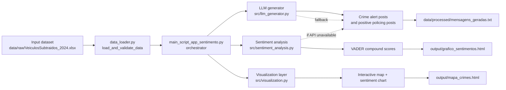

# Georeferenced Crime Sentiment Analysis

This project processes vehicle-theft records from São Paulo, generates social media
alerts, analyzes their sentiment, and creates an interactive crime map and a sentiment
chart.

Developed as part of the **MBA in Artificial Intelligence and Big Data** at the
**Institute of Mathematics and Computer Sciences, University of São Paulo (ICMC/USP)**.

## How it works

The main entry point, `main_script_app_sentimento.py`, reads the
`AMOSTRAGEM` sheet in `data/raw/VeiculosSubtraidos_2024.xlsx` and processes each
record:

1. Generates a vehicle-theft alert and a positive policing message.
2. Uses NLTK VADER to analyze both messages.
3. Chooses the policing-message prompt based on whether the crime alert's VADER
   compound score is negative.
4. Adds the incident to an interactive Folium map and includes both sentiment
   scores in an HTML chart.

The `src/` package contains reusable modules for data loading and validation,
message generation, VADER analysis, and visualization. The main script remains the
executable entry point.

## Architecture



The project follows a small ETL-style pipeline: the dataset is validated and loaded,
then each incident is transformed into social posts, scored with VADER, and
visualized in the final outputs.

## Language model

When an API key is configured, messages are generated through OpenRouter using
`google/gemma-4-26b-a4b-it:free`. This replaces the original script's
`LLaMA-3.2-3B-Instruct` model because that LLM became unavailable. If the API key
is missing or an API request fails, the script reports the issue and uses local
fallback messages instead.

Set either `OPENROUTER_API_KEY` or `OPENAI_API_KEY` before running to enable API
generation. For example, in PowerShell:

```powershell
$env:OPENROUTER_API_KEY = "your-api-key"
```

## Requirements and running

Use Python 3.10 or later. Install the dependencies and run the main script from
the repository root:

```powershell
python -m pip install -r requirements.txt
python main_script_app_sentimento.py
```

The script downloads the NLTK `vader_lexicon` resource if needed. The input
spreadsheet must be present at `data/raw/VeiculosSubtraidos_2024.xlsx`.

### Running with Docker

Build and run the image from the repository root. The image is tagged for the
Docker Hub repository `jacquevalenti/mbaproject`. The bind mounts keep generated
files on the host:

```powershell
docker build -t jacquevalenti/mbaproject:latest .
docker run --rm `
  -v "${PWD}/output:/app/output" `
  -v "${PWD}/data/processed:/app/data/processed" `
  jacquevalenti/mbaproject:latest
```

To publish the image, sign in to Docker Hub and push the tag:

```powershell
docker login
docker push jacquevalenti/mbaproject:latest
```

Set `OPENROUTER_API_KEY` in the container environment to enable API generation;
without it, the script uses local fallback messages.

## Generated files

- `output/grafico_sentimentos.html` — generated sentiment chart with an embedded image.
- `output/mapa_crimes.html` — generated interactive map with crime markers.
- `data/processed/mensagens_geradas.txt` — generated messages and sentiment scores.

The `src/` modules use these same output locations by default.
